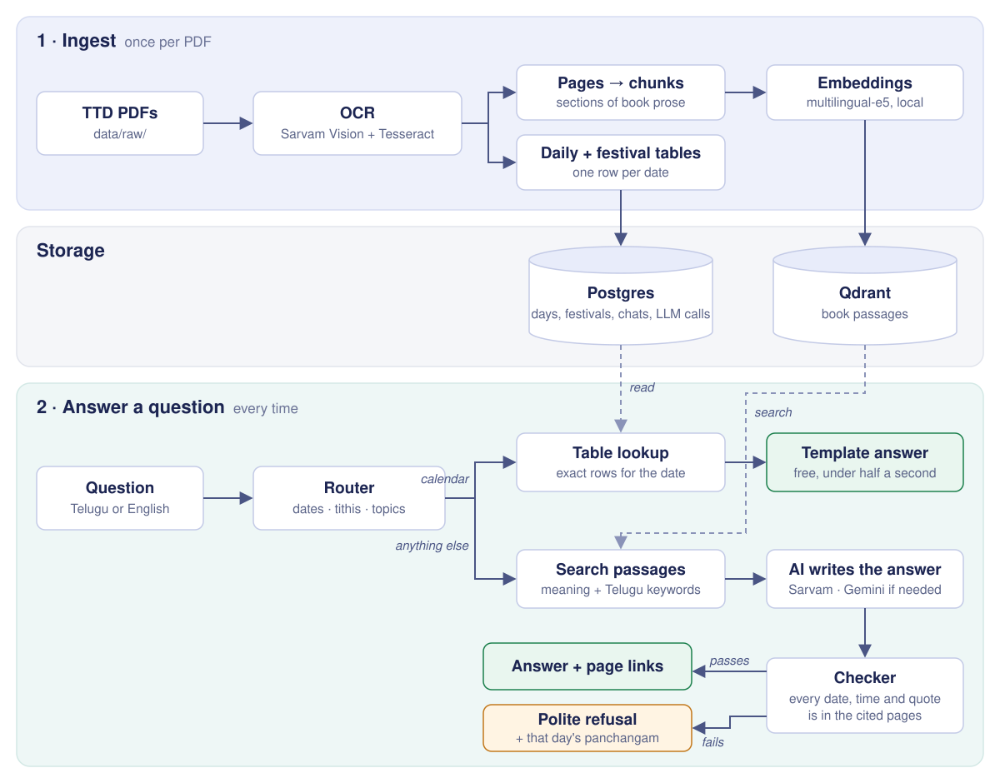
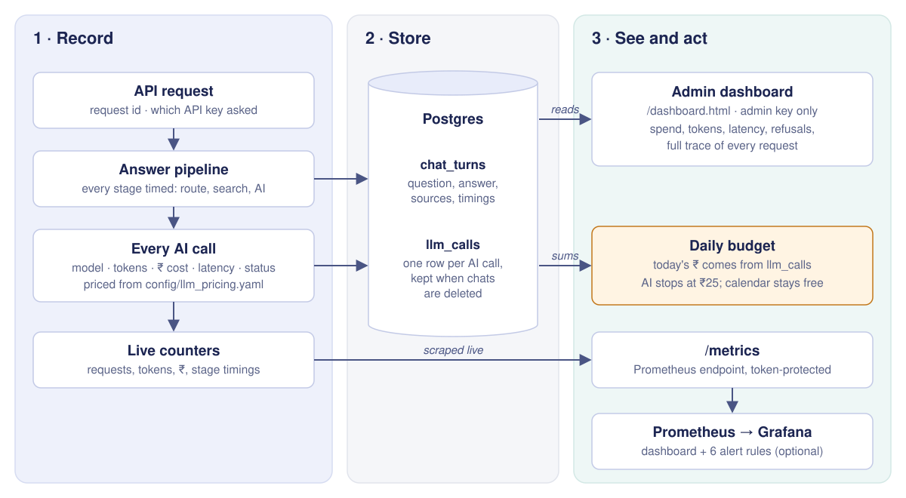

# PanchangaSetu AI

Ask the TTD panchangam a question in Telugu or English and get an answer taken from the book, with the
page it came from. When the book doesn't say, it tells you so instead of guessing.

```text
ఈరోజు రాహుకాలం ఎప్పుడు?          → రాహుకాలం: సాయంత్రం 4:30 నుండి సాయంత్రం 6:00 వరకు. (p. 83)
When is the next Ekadashi?        → Friday, 20 November 2026 (Kartika Shukla Ekadasi), until 2:04 AM.
When is Ugadi?                    → 19 March 2026, and 7 April 2027.             (festival calendar)
కుంభ రాశి వారికి డిసెంబర్ ఎలా ఉంది? → the book's Kumbha rasi prediction for December. (pp. 39–40)
Is tomorrow good for a business?  → the book has no rule for that, so here is tomorrow's full
                                    panchangam (tithi, nakshatram, rahukalam, festivals) to decide with.
```

- **Calendar questions** (tithi, nakshatram, rahukalam, sunrise, the next Ekadashi) are read straight
  from the book's tables. No AI model is involved, so they are instant and free.
- **Everything else** (meanings, rules, rasi phalalu, festivals) is written by an AI model from the
  matching book passages. A checker then confirms every date, time and quote against those passages
  before the answer is shown.
- **Follow-ups work:** "and tomorrow?", "what are its remedies?".
- A mobile-friendly web chat, an HTTP API with keys, and a monitoring dashboard for cost and latency.

## How it works



| Part | What it does | Where |
|---|---|---|
| Ingestion | Renders each PDF page, reads it with OCR, splits it into sections, and stores the text. Only new or changed files are processed. | `src/panchangasetu/ingestion/` |
| Structured tables | Reads the daily panchangam rows and the festival calendar into date-indexed tables. | `src/panchangasetu/structured/` |
| Index | Embeds book passages locally (no API key) and stores them in Qdrant. | `src/panchangasetu/retrieval/` |
| Router | Decides whether a question needs a table lookup, a passage search, or both. It understands dates such as "tomorrow", "రేపు" and "next Friday", plus tithi and nakshatra names. | `src/panchangasetu/query/` |
| Answering | Template answers for table questions; for the rest, the AI model is given the sources and every answer is checked. | `src/panchangasetu/generation/` |
| Conversations | Rewrites a follow-up into a complete question using the earlier turns. | `src/panchangasetu/conversation/` |
| API + web chat | FastAPI app, API keys, rate limits and the chat UI. | `src/panchangasetu/api/` |
| Monitoring | Every request and AI call is recorded with tokens, ₹ cost and latency; admin dashboard plus Prometheus/Grafana. | `src/panchangasetu/observability/`, [docs/monitoring.md](docs/monitoring.md) |

**AI models:**
- **Sarvam** (`sarvam-105b-conversations`) answers first: about ₹0.05–0.1 per answer, under a second.
- **Gemini** (Google AI Studio) takes over when Sarvam is unavailable. It also gets one more try when
  Sarvam can't produce a checked answer.
- LLM spend is capped per day (default ₹25). Calendar answers are free and keep working after the cap.

## Setup

You need:
- macOS or Linux with **Python 3.12**, **[uv](https://docs.astral.sh/uv/)**, **Docker** and **Tesseract**
  (`brew install tesseract`, or `apt install tesseract-ocr`)
- About **10 GB** of free disk space: the embedding model is about 2 GB, plus page images and the OCR cache
- A **Sarvam API key** ([dashboard.sarvam.ai](https://dashboard.sarvam.ai)), used for OCR and answers
- Optional: a **Gemini API key** ([aistudio.google.com](https://aistudio.google.com/apikey)) for fallback
  and harder questions

### 1. Install

```bash
git clone https://github.com/AdityaBellary/panchangasetu-ai.git
cd panchangasetu-ai
uv sync
cp .env.example .env
```

Open `.env` and set `SARVAM_API_KEY` (and `GEMINI_API_KEY` if you have one). `.env` is gitignored; never
commit it.

### 2. Start the databases

```bash
docker compose up -d postgres qdrant
uv run psetu db-upgrade
```

Postgres listens on `localhost:55432` and Qdrant on `localhost:6333`, both on this machine only.

### 3. Add the Telugu OCR model (fallback engine)

```bash
mkdir -p data/tessdata && cp "$(brew --prefix)/share/tessdata/"{eng,osd}.traineddata data/tessdata/
curl -L -o data/tessdata/tel.traineddata https://github.com/tesseract-ocr/tessdata_best/raw/main/tel.traineddata
```

On Linux, copy `eng`/`osd` from `/usr/share/tesseract-ocr/*/tessdata/` instead.

### 4. Add the PDFs

The PDFs are not in this repository. Download the TTD panchangam and TTD calendars from the
[TTD website](https://www.tirumala.org) and save them in `data/raw/` with these names:

| File | Contents |
|---|---|
| `TTD_panchangam.pdf` | Sri Parabhava nama samvatsara Siddhanti panchangam 2026–27 |
| `TTD-Calendar-2026.pdf` | TTD wall calendar 2026 |
| `TTD-Calendar-PDF-2027-*.pdf` | TTD wall calendar 2027 (any name matching this pattern) |

`config/collections.yaml` and `config/structured_sources.yaml` map these files to their page layouts. A
different edition needs its page ranges updated there.

### 5. Read and index the PDFs

```bash
uv run psetu ingest      # OCR every page (about 200 pages, Sarvam credits), build the tables
uv run psetu index       # embed passages into Qdrant (first run downloads the ~2 GB model)
uv run psetu status      # what was processed
```

Both commands only redo what changed, so running them again is cheap. To avoid Sarvam OCR costs, use
`uv run psetu ingest --engine tesseract`. It's free, but OCR quality on Telugu prose is noticeably lower.

### 6. Try it

```bash
uv run psetu ask "When is the next Ekadashi?" "ఈరోజు రాహుకాలం ఎప్పుడు?"
uv run psetu chat                        # terminal chat with follow-ups; /new starts over
```

### 7. Open the web chat

```bash
uv run psetu api-keys create family     # prints a key once; copy it
uv run psetu serve                      # http://127.0.0.1:8000
```

Open http://127.0.0.1:8000, paste the key, and ask. The browser remembers the key.

To use it from a phone on the same Wi-Fi, run `uv run psetu serve --host 0.0.0.0` and open
`http://<your-laptop-ip>:8000` on the phone. Only do this on a network you trust: the app has no HTTPS
of its own.

### Or run everything in Docker

```bash
docker compose up -d --build api                         # Postgres + Qdrant + API on :8000
docker compose exec api psetu ingest                     # first time only
docker compose exec api psetu index
docker compose exec api psetu api-keys create family
```

Give Docker at least 6 GB of memory. `./data` is mounted into the container, so PDFs, the OCR cache and the
models are shared with a local install.

## Monitoring



```bash
uv run psetu api-keys create ops --admin
```

Open `/dashboard.html` with that key. It shows questions, answer rate, ₹ spend against the daily budget,
tokens, latency per stage and per model, why answers were refused, and a full trace of every request and
AI call. `docker compose --profile monitoring up -d` adds Prometheus and Grafana with a ready-made dashboard
and alerts. See [docs/monitoring.md](docs/monitoring.md).

## Configuration

Every setting can be overridden in `.env` with the `PSETU_` prefix (see `src/panchangasetu/config.py`).
The ones you are most likely to change:

| Setting | Default | Meaning |
|---|---|---|
| `SARVAM_API_KEY` | – | OCR and answers |
| `GEMINI_API_KEY` | – | Fallback and harder questions (optional) |
| `PSETU_LLM_PROVIDERS` | `["sarvam","gemini"]` | Order the AI models are tried in |
| `PSETU_ESCALATION_PROVIDER` | `gemini` | Second try when Sarvam can't give a checked answer; `""` turns it off |
| `PSETU_LLM_DAILY_BUDGET_INR` | `25` | Daily AI spend cap in ₹ (`0` = no cap) |
| `PSETU_TIMEZONE` | `Asia/Kolkata` | What "today" means |
| `PSETU_API_RATE_LIMIT_PER_MINUTE` | `30` | Requests per minute per API key |
| `PSETU_SESSION_RETENTION_DAYS` | `180` | Conversations older than this are deleted |

AI prices used for the ₹ figures are in `config/llm_pricing.yaml`. English festival and topic names that
should match Telugu text (for example "Ugadi" → ఉగాది) are in `config/query_glossary.yaml`. Both can be
extended without code changes.

## HTTP API

Every `/v1/` request needs an `X-API-Key` header.

```bash
curl -s localhost:8000/v1/chat -H "X-API-Key: $KEY" -H 'content-type: application/json' \
  -d '{"question": "When is the next Ekadashi?"}'
```

The reply contains `answer`, `citations` (document, pages, date), `session_id` (send it back for
follow-ups), `method` (`template`, `llm` or `abstain`) and `cost_inr`. `GET /v1/today` returns today's
panchangam. The interactive docs are at `/docs`.

## Development

```bash
uv run pytest -m "not sarvam"                      # ~250 tests; no network, no paid calls
uv run pytest -m integration                       # needs the docker compose Postgres + Tesseract
uv run ruff check src tests && uv run ruff format --check src tests && uv run mypy src
```

Tests marked `sarvam` call the real Sarvam API and are excluded by default. CI (`.github/workflows/ci.yml`)
runs lint, type checks and the tests against a real Postgres, and builds the Docker image, on every push and
pull request. It uses no API keys.

Evaluation sets live in `eval/datasets/`. `uv run python eval/answer_eval.py --help` runs them; it calls the
AI models and costs credits.

```text
src/panchangasetu/
  ingestion/      PDF rendering, OCR, page classification, chunking
  structured/     daily panchangam and festival tables, weekday periods (rahukalam etc.)
  retrieval/      Qdrant index, table lookups, retrieval orchestration
  query/          language detection, dates, slots, routing, glossary expansion
  generation/     prompts, template answers, answer checking
  conversation/   sessions and follow-up rewriting
  providers/      Sarvam/Gemini chat, OCR engines, local embeddings
  api/            FastAPI app, API keys, web chat and dashboard
  observability/  logging, metrics, per-call cost tracking, ops queries
config/           document layouts, router examples, glossary, prices
migrations/       Alembic database migrations
monitoring/       Prometheus, alerts and Grafana provisioning
```
